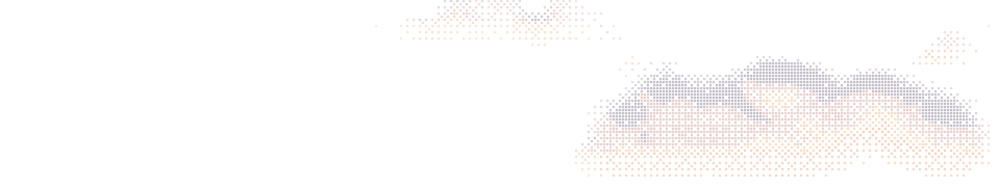

<a href="https://krumsultov.com">
  <picture>
    <source media="(prefers-color-scheme: dark)" srcset="assets/sky-night.png">
    <source media="(prefers-color-scheme: light)" srcset="assets/sky-dusk.png">
    
  </picture>
</a>

## Krum Sultov

I turn ideas into products that work as businesses, look right, and are built properly.

cs student at <a href="https://elsys-bg.org">TUES</a> · Sofia, Bulgaria

<pre>
A:\> load krum ........ ok
A:\> dir

 DIRECTORY OF A:\WORK

<a href="https://krumsultov.com/work/trustline/">TRUSTLIN.TXT</a>  2026  TrustLine: compliance that explains itself.
<a href="https://krumsultov.com/work/nelson/">NELSON.TXT</a>    2026  Nelson: the internet, for anyone with a phone.
<a href="https://icospherebio.com">ICOSPHER.TXT</a>  2025  Icosphere: a full identity for an oxford biotech.
<a href="https://github.com/krsultov/identiPay">IDENTIPA.TXT</a>  2025  identiPay: payments on self-sovereign identity.
<a href="https://github.com/SookX/Morzio">MORZIO.TXT</a>    2025  Morzio: credit scored from behaviour, not bureaus.
SOFIQUES.TXT  2024  SofiQuest: gamified city exploration.
<a href="https://labthread.com">LABTHREA.TXT</a>  2025  Lab Thread: a first identity, carried through print and events.

    7 FILE(S)   360K FREE
</pre>

[krumsultov.com](https://krumsultov.com) · [linkedin](https://www.linkedin.com/in/krumsultov)
